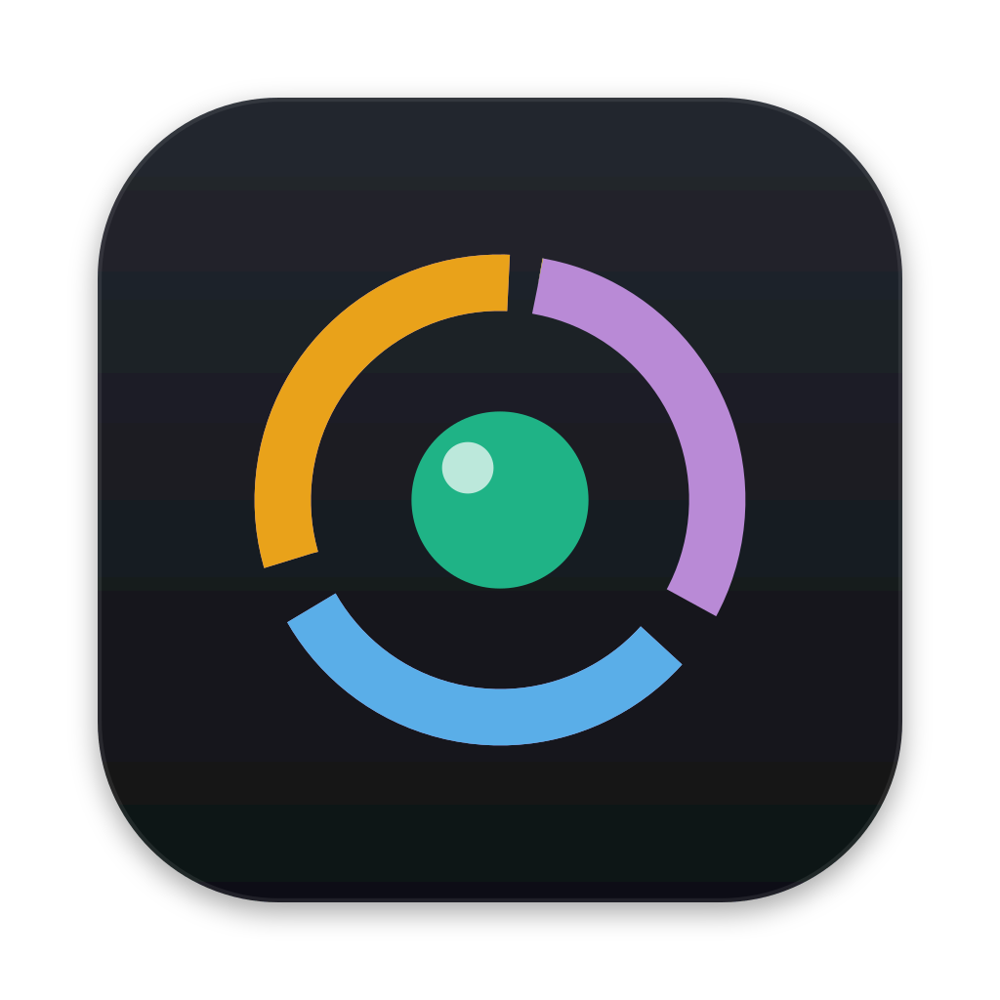
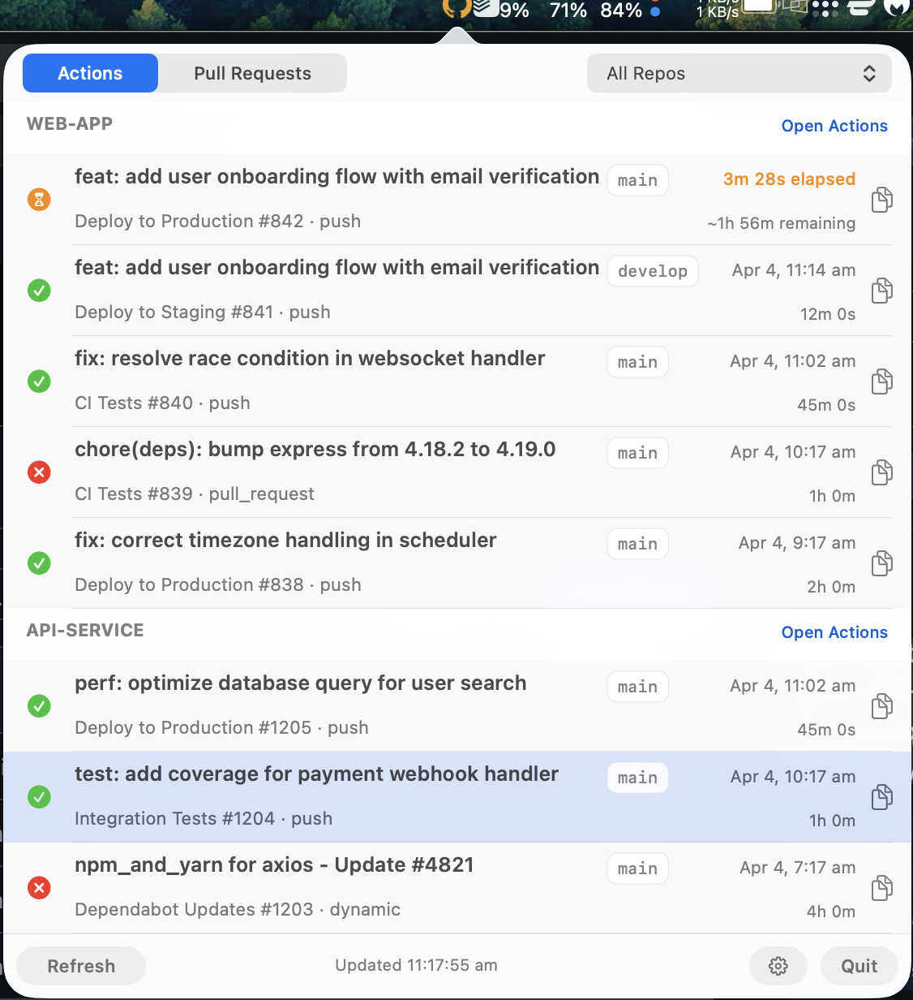
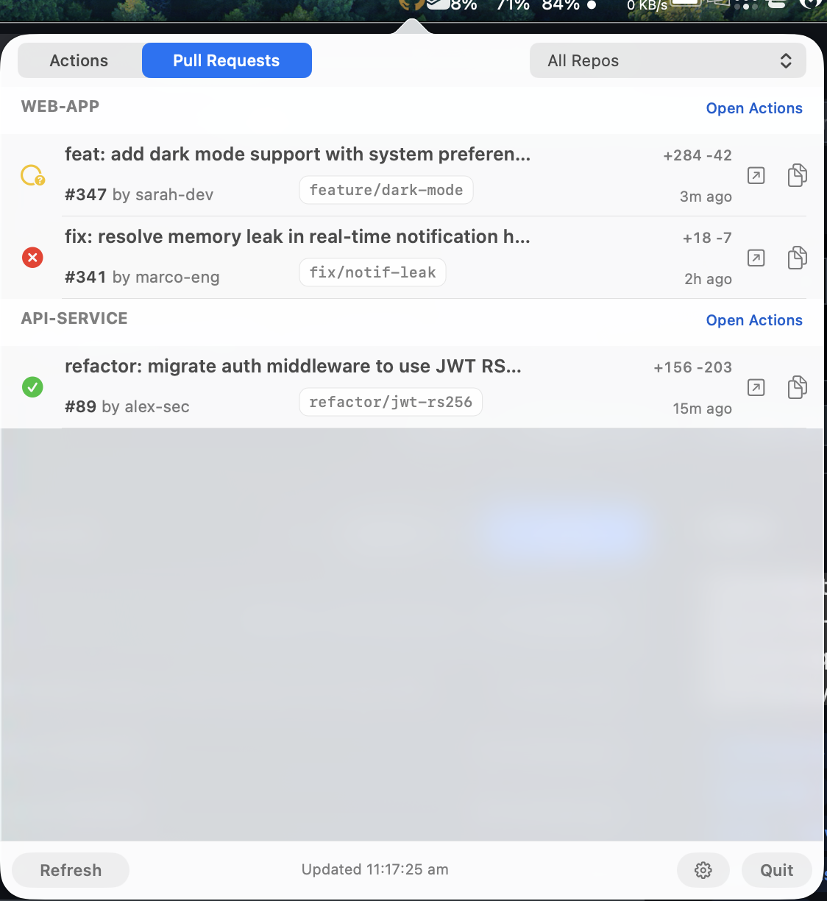
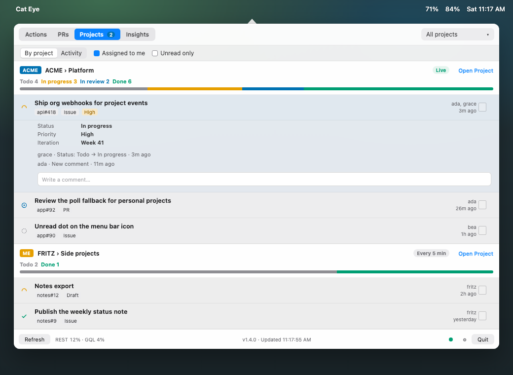

<p align="center"></p>

# OverSire — GitHub Actions & PR Monitor for macOS

> A lightweight, native macOS menu bar app for monitoring GitHub Actions, pull request reviews, Plane projects, and weekly CI health. Open source, about 1.3 MB, accessible, zero Electron.

**There are plenty of GitHub status apps out there.** Most are Electron wrappers that eat 200MB+ of RAM to show you a green checkmark. OverSire exists because a status indicator shouldn't cost more than the IDE it sits next to.

OverSire is built on three principles:

- **Extremely low footprint** — a native Swift binary of about 1.3 MB, ~35MB of RAM, zero frameworks beyond AppKit. No runtime, no bundled browser, no background bloat.
- **Minimalist** — just the important information: are your Actions passing, do any PRs need your review, and did a tracked project change. Deeper stats live behind the Insights tab, so the default view stays a status light, not a dashboard.
- **Accessible** — colour is never the only signal. Status uses the Okabe-Ito colour-blind-safe palette plus shape and text cues, and everything is keyboard navigable.

| Actions tab | Pull Requests tab | Projects tab |
|:-----------:|:-----------------:|:------------:|
|  |  |  |

## Features

### Actions Tab
- **Live status icon** — a ring of three arcs (tracker, CI, agents) around a status light. The light takes the status colour and shows a glyph (check / cross / hourglass), so state is readable without colour
- **Pulsing animation** — icon gently pulses when any action is actively running
- **Rich popover** — scrollable list of recent runs across all your repos, styled like the GitHub Actions UI
- **Per-run details** — workflow name, run number, branch badge, timestamps, and duration
- **Expandable run rows** — click a run to expand it inline: failed runs show the exact failure annotations (job/step + message), successful runs show the full commit message and durations, in-progress runs show live elapsed time and per-workflow status
- **Calculated ETA** — estimates remaining time for running actions based on historical durations
- **macOS notifications** — alerts for the run events you choose: starts, passes, failures, cancellations, and other endings — click a notification to open the popover

### Pull Requests Tab
- **Review queue** — shows PRs where your review is requested, across all tracked repos
- **Expandable detail** — click any PR to expand inline with full description and labels
- **PR actions** — approve, request changes, comment, merge (merge/rebase/squash), or close — all from the menu bar
- **Inline comments** — type and submit comments without leaving the popover
- **Safe input** — popover won't dismiss while you're typing a comment

### Projects Tab
- **Plane projects** — the work items of your [Plane](https://plane.so) projects, in one tab. The layers are workspace → project → work item
- **Many workspaces** — add each workspace with its own token in Settings → Projects. Plane Cloud and self-hosted Plane both work
- **By project or activity** — status chips and a stacked bar per project, or a feed of what changed
- **Item preview** — the key (for example `ENG-12`), a status chip, priority, assignees, and the latest comment
- **Sort order** — In progress, In review and Blocked items come first. Then Todo and Backlog items. Done and Cancelled items come last. In each state, the order is Urgent, High, Medium, Low, then no priority
- **Item window** — click a row to open the item in a separate window. The window shows the breadcrumb, the full title and a row of chips: status, priority, labels and assignees. Click a chip to change the value. **▶ Start** sets In progress and assigns you
- **Tabs** — **Overview** shows the description and the details. A long description stops after some lines: click **Show more**. **Sub-items** shows a progress ring and the sub-items. Click a sub-item to open it in the same window. **‹ KEY** or Esc goes back. **Activity** shows the comment box, the comments and the changes, newest first
- **Markdown** — the description shows as rendered Markdown, with tables and syntax highlight for code blocks. The switch at the top right of the description shows the Markdown source (**Code**). Comments show bold, code, links and bullets. Images in a description show in the window
- **Sub-items** — the list shows only top-level items. A ring and a count such as `3/5` show the done sub-items of an item. The ring is blue while sub-items are open, and green when all are done. To also list sub-items as rows, turn on Settings → Projects → "List sub-items as rows"
- **Change it in place** — set the status, priority, labels and assignees, edit the title and description (**Edit**, ⌘↩ saves, Esc cancels), or comment. OverSire changes Markdown to Plane rich text and back. Plane often does not record the new status of a change. OverSire then shows the status from the next change, or the status now
- **New item** — click **+** next to the filter, or press ⌘N. Set the state and the priority
- **Copy for agent** — copies the item as Markdown: title, facts, link, description and all comments. Paste it into a coding agent
- **Fold and reorder** — click a project header to fold it. A folded header shows one number: the items that are not done. Drag the grip to change the order
- **Hide Done items** — Settings → Projects → "Hide Done items" is Always, older than 1, 7 or 30 days, or Never. The default is older than 1 day
- **Filter** — press ⌘F and type. The filter looks in titles and descriptions. Esc clears it
- **Quick capture** — press ⌃⌥N in any app. OverSire opens New item with the clipboard text. Change the shortcut in Settings → Projects
- **Intake** — each project header shows two number chips: the items that are not done, and a purple chip such as `⇣ 38` for the intake items that wait for triage. A project with no items or no intake shows 0. Click the intake chip to open the intake window. Each row shows the key, for example `TREBI-264`. Type in the filter field (⌘F) to find titles or keys. Click an item to see its description and images. **‹ Intake** or Esc goes back to the list. ↑ and ↓ go to the previous and next item. **Accept** makes the item a work item. **Decline** asks first, then closes the item. The **…** menu has **Snooze** (1 day to 1 month), **Mark as duplicate**, **Copy work item link** and **Delete**
- **Progress bar** — each project header shows a bar of its items by status. A project without items shows an empty bar
- **macOS notifications** — mentions, comments, status, assignment, closed items, and intake items that are new, changed or closed. "My items" means you are an assignee or the author. Your own comments are skipped
- **Two update sources** — a workspace with a Plane webhook and live updates on is **Live**. A workspace without a webhook, or the cloud off, is **Polled**
- **Poll interval** — Settings → Projects → "Poll projects without live updates every" is 2, 5, 10, 15, or 30 minutes. The default is 5. Live projects use the same interval only while the cloud is disconnected

To add a workspace:

1. In Plane, open Profile settings → Personal access tokens and make a token. A token works only in its own workspace.
2. In OverSire, open Settings → Projects → Plane workspaces.
3. Type the workspace slug (the first part of the Plane URL) and the token. For a self-hosted Plane, change the host.
4. Click **Test & Add**. OverSire reads your user and the projects, and saves the token only if both work.

OverSire keeps the tokens in the Keychain, one for each workspace. A Plane webhook needs a workspace admin. If you are not an admin, the workspace stays on the poll and the live-updates panel says "Not a workspace admin".

### AI (optional)
AI helps in New item and in the editor. It is off until you set it up. Go to **Settings → AI**:

1. Select the format: **OpenAI** (`/chat/completions`) or **Anthropic** (`/v1/messages`). Any server with one of these formats works, for example a local server
2. Type the base URL, for example `https://api.openai.com/v1` or `https://api.anthropic.com`. The help line shows the full POST URL
3. Type the API key. OverSire keeps it in the Keychain, not in the config file
4. Type the model. For OpenAI, select the reasoning effort. "none" leaves the field out. For Anthropic, set Max tokens
5. Click **Test**. A pass enables the AI switch. If you change the format, the URL, the model or the key, you must test again
6. Click **Save & Apply**

What AI does:
- **Title and fields** — from the description, it suggests a title, two other titles, and field values. Click Suggest again for new ones
- **Tidy** — makes the description into clear Markdown. Undo is one click
- **Pick the project** — "✦ Auto" lets the AI select the project and tells you why

**Extra context** is text that OverSire adds to each prompt, for example your team words or title rules. OverSire sends only the text you see in the dialog and the names of the projects, fields and options.

### Orca agents (optional)
OverSire can start a coding agent on a Plane item in an [Orca](https://github.com/stablyai/orca) terminal. The Orca server can be this Mac or a paired server.

- **▶ Start** — hover a Todo or Backlog row and click ▶. The item window has the chip **▶ Start in Orca**. OverSire opens an Orca card with the item key as its name (for example `TOWERTAIL-2`). In it, OverSire starts `claude -n 'TOWERTAIL-2'` and sends the prompt. The copy menu of a row also has **Start in Orca**
- **Agent pill** — a row with an agent shows its state: **Starting…**, **Working 12m**, **Needs input**, **Agent done** or **Not started**. Click the pill to open the terminal in Orca. Click **Not started** to see the error, try again or choose another workspace
- **Agent card** — the Overview tab of the item window shows the agent, its last lines on the screen, **Send…** (type a reply to the agent) and **Open terminal**
- **Notifications** — "Agent needs input" and "Agent done". Turn them on or off in Settings → Projects → Notifications
- **The agent does the work** — ▶ does not change the Plane item. The agent sets In progress, does the work and closes the item. The default prompt is `work on {url} in worktree group .wt/{key}`

To set it up:

1. Install Orca. OverSire uses the CLI at `/Applications/Orca.app/Contents/Resources/bin/orca`.
2. Open Settings → Projects → Orca. Click **Test**. The status line shows the Orca version.
3. On a client Mac, set **Run agents on** to the paired server.
4. Set the Orca workspace of each Plane project. If you leave "— ask each time —", ▶ shows a menu of the Orca workspaces and saves your choice.

A workspace root often holds many repositories that depend on each other. The agent then makes a worktree group: one folder `.wt/<key>/` with a git worktree for each changed repository and a symlink for each other entry. The root `CLAUDE.md` tells the agent the rules of that root. The column "Root CLAUDE.md" in the settings shows whether the file tells the agent about worktree groups.

### Insights Tab
- **Deploy log** — every run OverSire sees is appended to `~/.config/oversire/deploys.jsonl`, so your history survives restarts
- **Last 7 days vs previous 7** — pass rate, average duration, deploy pass rate, and a per-workflow breakdown
- **Automatic insights** — slowest workflow, biggest failure source, and the branches that fail most
- **Copy report for AI** — copies a full markdown report plus a task prompt, ready to paste into Claude or ChatGPT

### General
- **Tabbed interface** — switch between Actions, PRs, Projects and Insights. Hide a tab from Settings → General
- **Repo filter** — "All Repos" or pick a specific repo; persists across tabs
- **Built-in setup** — login to GitHub and pick repos to track from the settings panel. Repos show as a tree per owner. Select an organization to track all its repos, also the repos that it adds later. The repo list is cached and refreshes in the background once a day.
- **Keyboard accessible** — navigate rows with Tab, activate with Return or Space
- **Shortcuts** — in the Projects tab: ⌘N new item, ⌘F filter, ⌘↩ save or create, Esc cancel, ⇧⌘V paste the clipboard in New item. In any app: ⌃⌥N quick capture
- **Colour-blind friendly** — status colours use the Okabe-Ito colour-blind-safe palette, and every state also carries a shape or text signal (badge glyphs, spelled-out statuses, tooltips)
- **Copy URL** — one-click copy of any run or PR URL to clipboard
- **Direct links** — click to open runs or PRs in GitHub
- **Multi-repo** — monitor as many repos as you want from a single widget
- **Adaptive polling** — 30s normally, 10s while the popover is open and a run is in progress (both configurable)
- **Hot-reload config** — change tracked repos from settings without restarting
- **Auto-detects `gh` CLI** — finds your GitHub CLI install automatically
- **Error feedback** — clear messages when gh CLI is missing, auth fails, or API errors occur
- **Tiny footprint** — about 1.3 MB, ~35MB memory, zero dependencies beyond macOS

## Requirements

- macOS 13+ (Ventura or later)
- [GitHub CLI](https://cli.github.com/) (`gh`) installed and authenticated (`brew install gh && gh auth login`)
- Apple Silicon or Intel Mac
- Xcode Command Line Tools only if building from source (`xcode-select --install`)

## Installation

> **Upgrading from an older build:** the bundle identifier changed to `com.oversire.app`. macOS treats that as a new app, so you will be asked for notification permission again, and any old `OverSire.app` should be deleted. Your settings in `~/.config/oversire/config.json` carry over untouched.

### Option 1: Homebrew (recommended)

```bash
brew tap flarco/tap
brew install oversire
```

Then launch with `open $(brew --prefix)/OverSire.app`.

### Option 2: Download binary

Get `OverSire.zip` from the [latest release](https://github.com/oversire/oversire/releases), unzip it, and move `OverSire.app` to Applications. The app is signed with a Developer ID and notarized by Apple, so it opens without a Gatekeeper warning. It runs on Apple silicon and Intel Macs.

### Option 3: Build from source

```bash
# Prerequisites (skip if already installed)
xcode-select --install   # Xcode Command Line Tools
brew install gh           # GitHub CLI

# Clone and build
git clone https://github.com/oversire/oversire.git
cd oversire
./build.sh

# Run
open OverSire.app
```

On first launch, the **Settings panel** opens automatically:

1. **Login** — click "Login..." to authenticate with GitHub (opens Terminal with `gh auth login --web`)
2. **Pick repos** — your repos and org repos are fetched automatically; check the ones you want to track
3. **Add manually** — type `owner/repo` in the "Add Repo Manually" field for repos not in the list
4. **Save** — click "Save & Apply" and you're monitoring

Reopen Settings any time via the gear icon in the footer. You can also **Logout** from the Settings panel.

### Make it findable via Spotlight / Raycast

```bash
# Symlink into ~/Applications (indexed by Spotlight)
ln -sf "$(pwd)/OverSire.app" ~/Applications/OverSire.app
```

Then search for **"OverSire"** in Spotlight or Raycast.

### Auto-start on login

```bash
cat > ~/Library/LaunchAgents/com.oversire.plist << 'EOF'
<?xml version="1.0" encoding="UTF-8"?>
<!DOCTYPE plist PUBLIC "-//Apple//DTD PLIST 1.0//EN" "http://www.apple.com/DTDs/PropertyList-1.0.dtd">
<plist version="1.0">
<dict>
    <key>Label</key>
    <string>com.oversire</string>
    <key>ProgramArguments</key>
    <array>
        <string>/usr/bin/open</string>
        <string>/path/to/oversire/OverSire.app</string>
    </array>
    <key>RunAtLoad</key>
    <true/>
</dict>
</plist>
EOF

# Enable it
launchctl load ~/Library/LaunchAgents/com.oversire.plist
```

Replace `/path/to/oversire/` with your actual install path.

## Configuration

Config lives in `~/.config/oversire/config.json` (managed via the Settings panel, or edit directly):

```json
{
    "repos": [
        "myorg/backend",
        "myorg/frontend",
        "myuser/side-project"
    ],
    "pollInterval": 30,
    "pollActiveInterval": 10,
    "runsPerRepo": 10,
    "filterDefaultBranches": false,
    "notifications": {
        "started": true,
        "succeeded": true,
        "failed": true,
        "cancelled": true,
        "other": true
    },
    "projects": {
        "workspaces": [{ "slug": "acme", "host": "https://api.plane.so" }],
        "picked": ["acme/9e6e2e1d-7721-4957-967e-601332a1ad47"],
        "allOf": [],
        "pollMinutes": 5,
        "showTab": true,
        "order": [],
        "folded": [],
        "capture": { "enabled": true, "keyCode": 45, "modifiers": 6144, "pasteClipboard": true, "aiTitle": true }
    },
    "ai": {
        "format": "openai",
        "baseURL": "https://api.openai.com/v1",
        "model": "gpt-5-mini",
        "effort": "low"
    }
}
```

| Key | Default | Description |
|-----|---------|-------------|
| `repos` | `[]` | GitHub repos to monitor (`owner/repo` format) |
| `pollInterval` | `30` | Seconds between checks when idle |
| `pollActiveInterval` | `10` | Seconds between checks while the popover is open and a run is in progress |
| `runsPerRepo` | `10` | Number of recent runs to fetch per repo |
| `filterDefaultBranches` | `false` | Hide workflow runs from branches other than `main` or `develop` |
| `sortByRecent` | `true` | Show the runs of all repos in one list, newest first. Active runs come first. Each row has a colored chip with the repo name. Set to `false` to show each repo in its own section and to group the workflows of one commit in one row |
| `oneRowPerWorkflow` | `true` | Show only the latest run of each workflow on each branch |
| `repoColors` | (set by the app) | The palette slot (0–11) of each repo chip. The app gives each new repo the least used slot. Change a number to change a color |
| `autoUpdate` | `true` | Install new releases automatically, written by **Settings → Updates** |
| `notifications` | all `true` | macOS notification switches in **Settings → Notifications**. `failed` includes timeouts and startup failures; `other` covers skipped and other completed conclusions |
| `relay` | none | Cloud settings, written by **Settings → Cloud (beta)** (see below) |
| `projects.workspaces` | `[]` | Plane workspaces: `slug` and `host`. The tokens are in the Keychain. Add them in Settings → Projects |
| `projects.picked` | `[]` | Projects to track, as `slug/project-uuid` |
| `projects.allOf` | `[]` | Workspace slugs whose projects are all tracked, including ones added later |
| `projects.pollMinutes` | `5` | How often to poll projects that are not live. One of 2, 5, 10, 15, 30 |
| `projects.showTab` | `true` | Show the Projects tab |
| `projects.hideDoneAfterDays` | `1` | Hide Done items older than this many days. `-1` always hides them. `0` never hides them |
| `projects.order` | `[]` | The project order, written when you drag a header. Projects not in the list come after, by workspace and title |
| `projects.folded` | `[]` | Folded projects |
| `projects.showSubItems` | `false` | List sub-items as rows. When it is off, the list shows top-level items only, with a sub-item ring |
| `projects.capture` | on, ⌃⌥N | Quick capture: `enabled`, the Carbon `keyCode` and `modifiers`, `pasteClipboard` and `aiTitle`. Set it in Settings → Projects |
| `projects.orca` | on, `claude` | Orca agents: `enabled`, `cli` (the path of the Orca CLI), `environment` (the paired Orca server, or none for this Mac), `agent`, `prompt` and `roots` (the Orca workspace path of each project key; `""` asks each time) |
| `ai` | off | AI settings, written by **Settings → AI**. The API key is in the Keychain |

## Updates

A release build (from the [releases page](https://github.com/oversire/oversire/releases)) checks GitHub for a new release at launch and every 4 hours. It downloads the release and installs it only if the bundle is signed with the OverSire Developer ID and notarized by Apple. Then it restarts. It does not restart while the popover is open. If the new version does not start, the previous version comes back.

**Settings → Updates** shows the current version. Use it to turn off automatic installs, or to check now. Builds from source have a `-dev` version and do not update themselves. Use `./update.sh` for those.

## Cloud (beta, optional)

By default, OverSire polls GitHub and Plane. OverSire cloud adds a push path: GitHub and Plane send webhooks to the cloud, and the cloud tells each Mac about changes in about one second. Polling stays on as a slow fallback (every 10 minutes by default).

The cloud runs from the private `oversire/cloud` repo. Its README tells how to deploy it. Each user has an OverSire Cloud account. You log in to the console with a code that comes by mail.

To connect a Mac, get a pairing code in the console. Then open **Settings → Cloud (beta)**. Enter the cloud URL and the pairing code, then click **Connect**. The cloud gives this Mac a device token for the code, one time only. OverSire keeps the token in the Keychain. A device token from an old single-tenant relay also works in the same field. Then click **Install hooks**. OverSire adds a webhook to each tracked repo (`gh` must have admin access to the repo; other repos stay on polling).

Each Plane workspace gets one webhook to `https://<cloud>/plane/<slug>`. **Settings → Cloud (beta) → Plane webhooks** shows one row per workspace. OverSire adds the webhook when you add a workspace, and deletes it when you remove the workspace. The cloud keeps the secret of each webhook and checks the `X-Plane-Signature` of each delivery. A workspace without a webhook polls every `pollMinutes` (5 by default). Note: Plane sends no webhook event for changes made through its v1 API. OverSire refreshes after its own changes. Plane has no intake webhook events. An intake item is also a work item, so its changes come as work item events. OverSire then reads the intake list again.

A Cat Eye relay (v3) that you deployed before also works. OverSire moves its URL and token on the first start.

- **Retention:** the cloud keeps events for 24 hours by default (1 hour to 30 days). A Mac that was offline reads the events it missed. After a longer gap, it does one full refresh.
- **Privacy:** the cloud keeps only repo names, Plane workspace slugs, event types and IDs (run, job, pull request, project, work item). It does not log payloads, titles, bodies, or user names. Each webhook is verified with an HMAC secret.

### Cloud AI

OverSire Cloud can also run AI jobs on the server, for example triage of new items, the reason a CI run failed, or a daily digest. A job only writes suggestions. You accept or dismiss each suggestion, and nothing changes before that. An accepted suggestion can send a work order to a runner on your Mac, which starts, reads or stops a coding session. **Settings → Cloud (beta)** and **Insights** show the Jobs, Suggestions and Runner sections. Without a cloud account, they only tell what each one does.
- **Disconnect:** **Disconnect** deletes the token from the Keychain. The webhooks stay, because other Macs can use them.

## Using the PRs tab

Switch to the **PRs** tab to see pull requests where your review is requested.

- **Expand a PR** — click any PR row to expand it inline, showing the description, labels, and action buttons
- **Approve** — click "Approve" (optionally type a comment first)
- **Request changes** — type your feedback in the comment field, then click "Changes" (comment is required)
- **Comment** — type in the comment field and click "Comment"
- **Merge** — pick a merge strategy (Merge commit / Rebase / Squash) from the dropdown, then click "Merge"
- **Close** — click "Close", then confirm by clicking "Sure?" (auto-resets after 3 seconds)
- **Filter** — use the repo dropdown in the top bar to focus on a specific repo

When a PR is expanded, the popover switches to **semitransient** mode so it won't close while you're typing a comment.

## Building from source

```bash
# Requires Xcode Command Line Tools
xcode-select --install

# Build (produces OverSire.app)
./build.sh
```

The Markdown renderer uses [markdown-it](https://github.com/markdown-it/markdown-it) and [highlight.js](https://highlightjs.org) in a `WKWebView`. The files are in [`assets/markdown/`](assets/markdown/), and `build.sh` copies them into the app. The app does not load them from the network.

## How it works

- Uses the `gh` CLI under the hood — no API tokens to manage, no OAuth flows. If `gh auth status` works, OverSire works.
- Fetches runs via `gh api repos/OWNER/REPO/actions/runs` and PRs via `gh pr list --search review-requested:@me`, for every configured repo, all concurrently.
- The 10-second poll runs only while the popover is open. Closed, OverSire falls back to the normal interval — measured on a real machine, that took a long CI run from 1,148 GitHub API calls/hour down to 382.
- PR actions (approve, comment, merge, close) call `gh pr review`, `gh pr comment`, `gh pr merge`, and `gh pr close` respectively.
- With live updates on, a workflow or pull request event refreshes only the repo it is about. A project event refreshes the matching project. The footer dot shows the cloud state (green = live, grey = polling, orange = cloud error). The footer also shows the REST and GraphQL quotas side by side.
- Project snapshots come from the Plane REST API (`/api/v1`, with the `X-Api-Key` header). OverSire reads comments only for items with new activity. The first snapshot of a project creates no activity, so launch stays quiet.
- Runs as a macOS accessory app (no Dock icon, no Cmd+Tab entry).
- Notifications use the native `UserNotifications` framework — respects Do Not Disturb and Focus modes.

## Menu bar icon states

Colours come from the [Okabe-Ito colour-blind-safe palette](https://jfly.uni-koeln.de/color/), and each state also shows a glyph in the light at the centre of the ring, so it's readable without colour perception.

| Icon | Badge | Meaning |
|------|-------|---------|
| Bluish green | Checkmark | The latest run of each workflow passed |
| Vermillion | Cross | The latest run of a workflow failed |
| Sky blue (pulsing) | Hourglass | A run is currently in progress |
| Gray | — | No data or no repos configured |

Each workflow on each branch counts. A newer run of the same workflow replaces an old failure. To keep a failure from turning the icon red, ignore that run. To skip feature branches, select **Default only**.

A small blue dot on the icon means a tracked project has unread activity. The CI colour still wins. Turn the dot off in Settings → Projects.

## Troubleshooting

| Problem | Fix |
|---------|-----|
| Icon stays gray, "GitHub CLI not found" | Install gh: `brew install gh` and restart OverSire |
| "Not authenticated" error | Run `gh auth login` in Terminal, or click Login in Settings |
| "No access" or a 404 from `gh` | The token expired or lost a scope. GitHub answers 404, not 401, for a private repo it cannot see — run `gh auth login` |
| No PRs showing | The PR tab only shows PRs where **your review is requested** — not all open PRs |
| "Plane does not accept the token" | The token is not for that workspace, or it expired. Make a new token in that workspace |
| A workspace stays on polling | A Plane webhook needs a workspace admin. Also check that the cloud is up to date |
| Quick capture shortcut does nothing | Another app has the shortcut. Settings → Projects shows the error. Record a different shortcut |
| AI switch is disabled | Click Test in Settings → AI. A change to the format, URL, model or key needs a new test |
| Popover closes while typing | Expand a PR or open an item first — this switches to semitransient mode |
| Config changes not taking effect | Click "Save & Apply" in Settings — no restart needed |
| Build fails | Ensure Xcode Command Line Tools are installed: `xcode-select --install` |

## Why OverSire?

| | OverSire | Typical Electron app |
|---|---|---|
| **Binary** | ~1.3 MB | 150–300 MB |
| **Memory** | ~35 MB (0.2%) | 200–400 MB |
| **CPU at idle** | 0% | 0.5–2% |
| **Dependencies** | macOS + `gh` CLI | Node.js, Chromium, npm packages |
| **Startup** | Instant | 2–5 seconds |

OverSire is native Swift, compiled to one binary. No runtime, no garbage collector, no bundled browser engine. It wakes up on its poll interval, runs a few `gh` CLI commands, updates a menu bar icon, and goes back to sleep.

## Process info

| | |
|---|---|
| **Process name** | `oversire` |
| **Spotlight name** | OverSire |
| **Binary size** | ~1.3 MB |
| **Memory** | ~35 MB / 0.2% on 16GB Mac |
| **Bundle ID** | `com.oversire.app` |

## Contributing

Contributions welcome — see [CONTRIBUTING.md](CONTRIBUTING.md). The short version: keep it lean (native Swift, zero dependencies), keep it secure, keep it accessible.

## License

[MIT](LICENSE)
